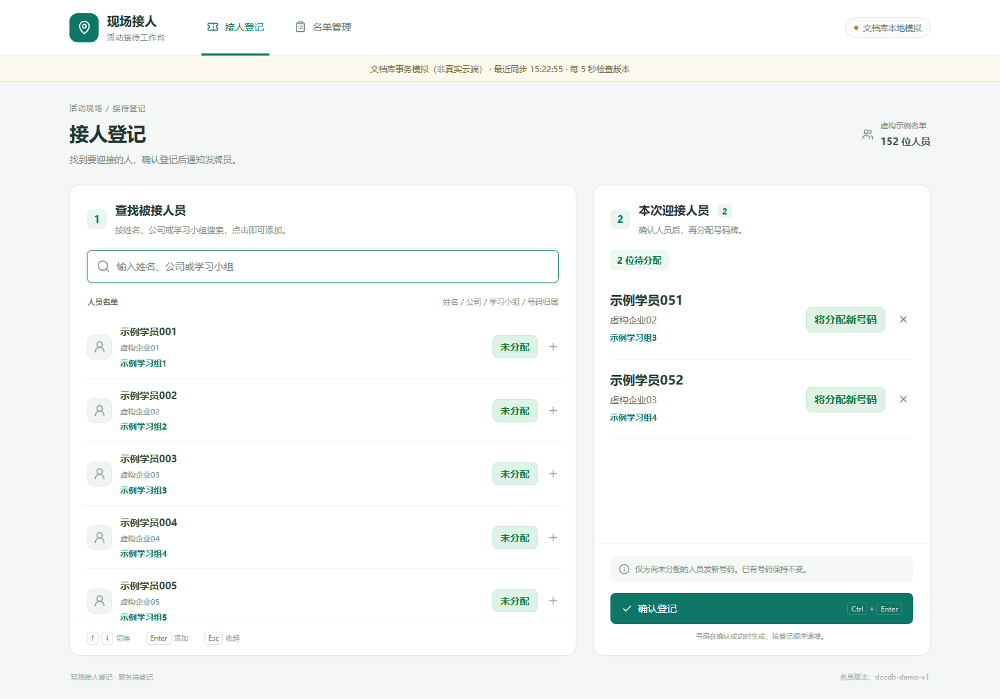
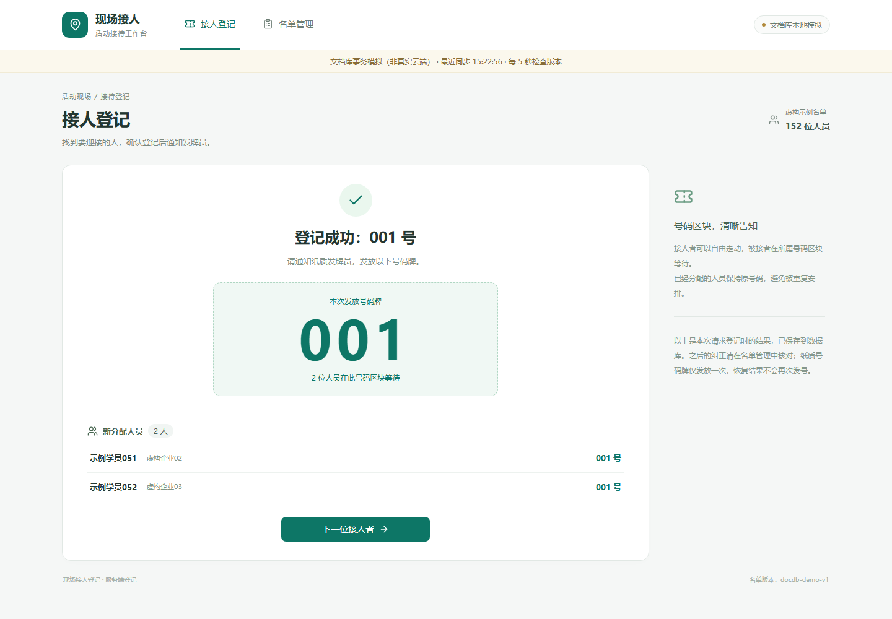
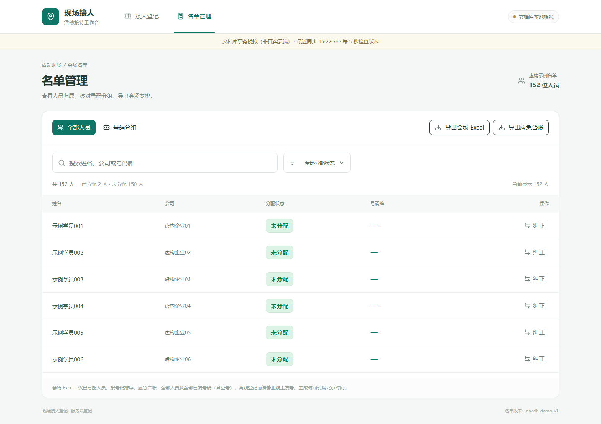
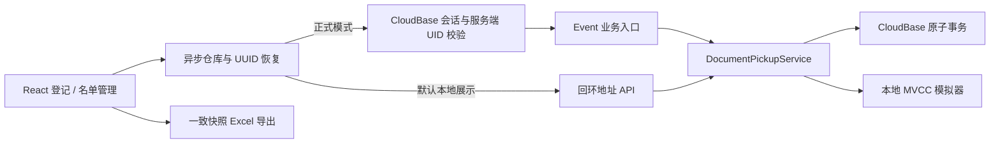

# 接人登记系统 · Pickup Registration System

面向培训活动结束后的现场接人工作。接人者说明要迎接的人员，工作人员搜索名单、登记并通知发牌员；人员按照所属号码区块等待。同一人可能被多批接人者登记，但只能有一个号码归属。

项目来自实际使用过的 CloudBase 文档数据库系统，已完成业务开发、真云验证及使用方审核；早期 MySQL 阶段曾接受独立源码审查，最新展示版尚未另行独立审查。本仓库是独立脱敏的技术展示版本，不包含实际活动名单、账号、部署地址或云配置，也不连接原线上系统。源码包含文档库正式入口和最新登录用户显示，不是只有静态页面的旧版 Demo。

## 页面预览

以下截图在本地使用全部虚构的152条名单生成。页面中的“文档库本地模拟”表示演示环境，不将截图宣称为生产验证。





## 业务能力

- 姓名、企业、学习小组即时搜索；鼠标及上下方向键选择、Enter 添加、Ctrl+Enter 提交，处理中文输入法组合状态。
- 空搜索不得 Enter 误选；多候选必须明确选择；同一批不能重复添加。
- 一批未安排人员共用新号码；已有归属保持不变；全员已安排时不再发号。
- 号码只在成功提交时分配，空号保留；人员最多归属一个号码。
- 登记完成明确提示号码及既有归属，点击“下一位接人者”开始下一批。
- 名单查询、分组、版本校验的纠正；页面可见时每5秒检查版本，有变化才取快照，聚焦刷新。
- 会场 Excel 按号码分组、合并同号、交替底色和边框；应急台账包含全部人员、空号和续号信息。两种导出均不增加学习小组列。
- 正式云模式使用 CloudBase 内置用户名密码认证、会话恢复及退出；五 UID 同权限，服务端可信身份授权；无注册、角色后台或自行存储密码。

## 技术栈与架构

React 19、TypeScript、Vite、Tailwind CSS、shadcn/ui New York、Lucide；CloudBase Web/Node SDK、文档数据库 Event 云函数；ExcelJS；Vitest 与 Playwright。保留早期 MySQL 事务实现作为历史对照，默认展示不需要 MySQL。



**模块职责：** `src/components/` 为业务页面和登录门禁；`src/services/` 为本地、HTTP、CloudBase 适配和导出；`shared/` 为接口、校验及名单哈希；`cloudfunctions/pickup-docdb/` 为正式授权入口、业务服务和数据库端口；`local-tools/` 为模拟器；`tests/` 包含单元、浏览器和可选 MySQL 集成测试。

## 并发、事务与异常恢复

文档库使用 control 文档作为写冲突锚点，将递增号码、人员归属块、号码记录和 UUID 回执放在同一事务内提交。竞争失败不产生部分登记；仅对明确的事务冲突进行有限重试，不用前端按钮或云函数内存锁保证正确性。名单分块、哈希和版本用于完整性与一致快照校验。

同一 UUID 重放返回既有回执，响应丢失后保留请求并恢复原结果。纠正使用人员版本检测竞争；清空一个号码的人员不会回收号码。无法确认提交结果时暂停新提交，提醒工作人员恢复原请求。

页面刷新可利用当前浏览器保存的请求恢复线索。跨浏览器未确认请求恢复工作台未实现，不能声称可以自动处理所有网络事故。模拟器用于本地自动化，不证明云平台隔离、计费或未来时延。

## 本地运行

Node.js 20.19+ 或22.12+，推荐受支持的 LTS 版本。

```sh
npm ci
npm run dev
```

打开 http://127.0.0.1:5190 。此命令同时启动回环 API 与现有文档库业务服务，数据仅保存在忽略提交的 `.local-runtime/`。无需云账号、密钥或登录即可体验虚构名单；此入口不模拟正式账号授权，授权由独立测试覆盖。

```sh
npm test
npm run build
npx playwright test
npx playwright test --config playwright.auth.config.ts
npx playwright test --config playwright.docdb.config.ts --project chromium
```

首次使用 Playwright 如缺 Chromium：`npx playwright install chromium`。浏览器测试使用独立端口和虚构数据，不运行真实登记。`npm run dev:demo` 是保留的纯内存对照模式，默认入口已经改为文档库本地适配。

`npm run build:docdb-formal` 编译正式登录前端；空配置可构建但不能连接云端。展示版强制使用虚构名单，云模式填写连接参数后仍须显式设置 `PICKUP_ENABLE_CLOUD=true`。如自行部署，只使用自己独立的测试环境，不复用原生产环境。UID 仅配置在服务端。`deployment/formal-function/` 提供无凭据的根入口模板；通用后端打包脚本的默认入口不是正式授权入口，不能直接公开管理入口。

## 验证范围与局限

原项目已完成真实 CloudBase 的同人竞争、连续发号、UUID 重放与恢复、纠正冲突、回滚、网页同步和 Excel 对账；内置认证五账号登录及未授权请求拒绝也完成过真云验证。本公开版本不附原始业务日志，不在本轮重复访问生产资源。

本次脱敏副本的实际执行结果见 [测试与公开安全核查](docs/验证记录.md)。本地测试与历史真云验收分别记录，避免把模拟测试等同于云端验证。

未承诺所有现场设备和网络、长期高并发、未来冷启动时延、资源额度或零费用。原 MySQL 集成测试依赖额外本地数据库，不属于默认测试。大 SDK / ExcelJS 分包及历史代码风格保留，未为作品展示进行无关重构。

## 展示版安全边界

独立干净 Git 历史，未复制原 `.git`、环境文件、真实 JSON/Excel、生产构建产物、账号 UID/密码、数据库快照和日志。账号测试标识均为虚构名称；文档不提供生产域名或资源标识。

仅虚构页面截图可入库；其余截图、日志、环境和构建文件继续忽略。原项目真实资料仍留在原目录，不删除、不覆盖。本项目为作者在职期间为所在单位开发，本仓库是脱敏技术展示版本。
